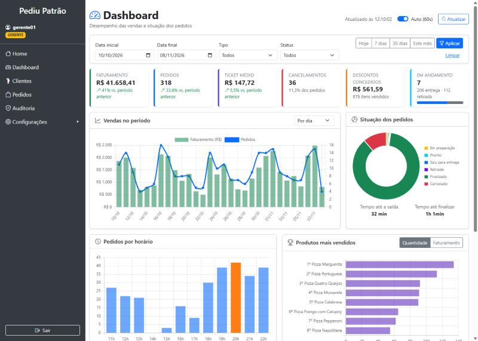
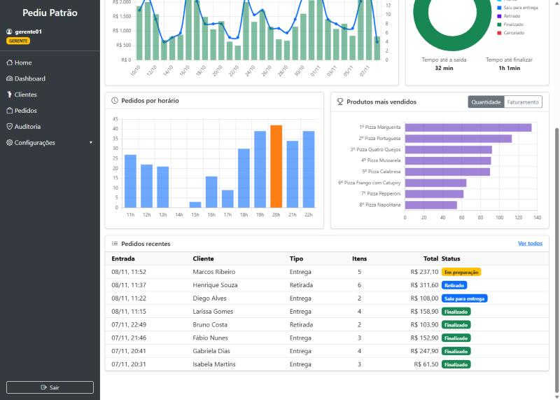
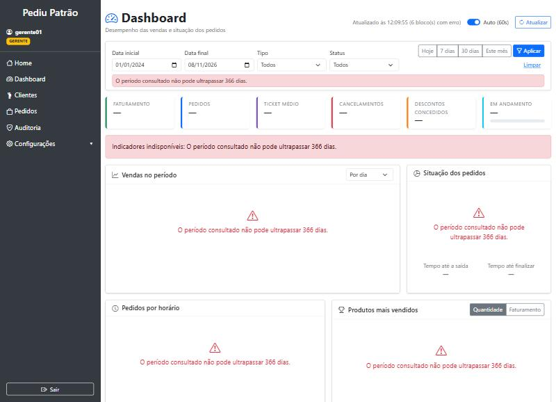
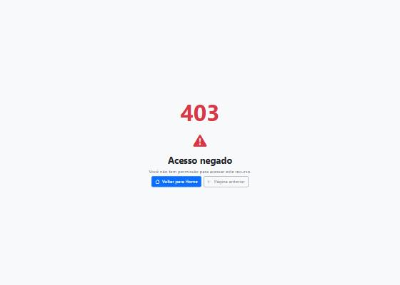

# Dashboard Administrativo — PediuPatrão

Atividade Prática M2: Dashboard Administrativo integrado ao sistema de pedidos **PediuPatrão**.

O painel permite que o responsável pelo estabelecimento acompanhe o desempenho das vendas, visualize
a situação dos pedidos e identifique tendências da operação. Todos os dados exibidos são obtidos por
uma API REST projetada e implementada nesta atividade, integrada ao banco MongoDB do sistema.

**Sumário**
1. [Visão geral da solução](#1-visão-geral-da-solução)
2. [Requisitos funcionais](#2-requisitos-funcionais)
3. [Requisitos não funcionais](#3-requisitos-não-funcionais)
4. [Decisões de análise e projeto](#4-decisões-de-análise-e-projeto)
5. [Documentação dos endpoints](#5-documentação-dos-endpoints)
6. [Evidências de testes](#6-evidências-de-testes)
7. [Fluxo de branches (Gitflow)](#7-fluxo-de-branches-gitflow)
8. [Como executar](#8-como-executar)

---

## 1. Visão geral da solução



```
 Navegador (ADMIN / GERENTE)
 ┌───────────────────────────────┐         ┌──────────────────────────────┐        ┌───────────┐
 │ /dashboard (Thymeleaf)        │  fetch  │ DashboardApiController       │        │  MongoDB  │
 │ dashboard.js + Chart.js       │ ──────► │  GET /api/dashboard/*        │        │           │
 │ indicadores, gráficos,        │  JSON   │        │                     │ query  │ pedidos   │
 │ ranking, filtros              │ ◄────── │ DashboardService             │ ─────► │ (índice   │
 └───────────────────────────────┘         │  regras e cálculos           │        │ dataHora- │
                                           └──────────────────────────────┘        │ Entrada)  │
          Spring Security: sessão + perfil (ADMIN/GERENTE) em todas as camadas      └───────────┘
```

| Camada | Arquivo |
|--------|---------|
| Tela | `templates/dashboard.html`, `static/js/dashboard.js` |
| API REST | `controller/DashboardApiController.java` |
| Regras de negócio | `service/DashboardService.java` |
| Contratos (DTOs) | `dto/dashboard/DashboardDtos.java`, `dto/dashboard/FiltroDashboard.java` |
| Dados de demonstração | `config/DemoDataInitializer.java` |
| Segurança | `config/SecurityConfig.java` (`/dashboard` e `/api/dashboard/*`) |

---

## 2. Requisitos funcionais

| ID | Requisito | Como foi atendido |
|----|-----------|-------------------|
| **RF01** | **Indicadores gerais de vendas** | Cartões com faturamento, quantidade de pedidos, ticket médio, cancelamentos (quantidade e taxa), descontos concedidos, itens vendidos, pedidos em andamento e divisão entrega × retirada. Faturamento, pedidos e ticket médio mostram a **variação em relação ao período anterior** de mesmo tamanho. Endpoint `GET /api/dashboard/resumo`. |
| **RF02** | **Análise de vendas (gráficos)** | Gráfico combinado de faturamento (barras) e pedidos (linha) no período, agrupável **por dia, semana ou mês**; gráfico de **pedidos por horário** com destaque para o horário de pico. Endpoints `GET /api/dashboard/vendas` e `GET /api/dashboard/vendas-por-hora`. |
| **RF03** | **Situação dos pedidos** | Gráfico de rosca com a quantidade por status (Recebido, Em preparação, Pronto, Saiu para entrega, Retirado, Finalizado, Cancelado), **tempo médio até a saída e até a finalização**, e tabela com os **pedidos mais recentes** (clicável, abre o detalhe do pedido). Endpoints `GET /api/dashboard/situacao-pedidos` e `GET /api/dashboard/pedidos-recentes`. |
| **RF04** | **Produtos mais vendidos** | Ranking por **quantidade** ou por **faturamento**, com participação percentual de cada produto. Endpoint `GET /api/dashboard/produtos-mais-vendidos`. |
| **RF05** | **Filtros de consulta** | Data inicial e final, atalhos (Hoje, 7 dias, 30 dias, Este mês), tipo de entrega e status. Os filtros valem para todos os blocos. As opções vêm da API (`GET /api/dashboard/filtros`). |
| **RF06** | **Integração com a API** | A tela não recebe dados do servidor na renderização: todos os blocos consultam os endpoints `/api/dashboard/*` via `fetch` com a sessão do usuário. |
| **RF07** | **Atualização e tratamento de dados** | **Atualização automática a cada 60 s** (pode ser desligada; pausa com a aba oculta) e botão *Atualizar*, com horário da última atualização. Cada bloco carrega de forma independente, com estados de **carregando**, **vazio** ("Nenhuma venda no período") e **erro** (mensagem da API). Validação dos filtros no navegador e no servidor (400). Sessão expirada redireciona ao login. No servidor: pedidos cancelados não entram no faturamento, períodos sem venda aparecem com zero, divisões por zero são tratadas e a variação fica nula quando não há base de comparação. |

**Regras de negócio adotadas**

- **Faturamento** = soma do `valorTotal` (já com desconto) dos pedidos **não cancelados** do período.
- **Ticket médio** = faturamento ÷ pedidos não cancelados.
- **Taxa de cancelamento** = cancelados ÷ total de pedidos do período.
- **Em andamento** = Recebido, Em preparação, Pronto, Saiu para entrega ou Retirado (ainda não finalizado nem cancelado).
- **Período anterior** (comparativo) = mesma quantidade de dias imediatamente antes do período filtrado.
- O período considera a **data/hora de entrada** do pedido, no fuso `America/Sao_Paulo`.
- Ranking de produtos considera os itens dos pedidos não cancelados, agrupados pelo produto.

---

## 3. Requisitos não funcionais

| ID | Categoria | Requisito | Como foi atendido |
|----|-----------|-----------|-------------------|
| RNF01 | Segurança | Somente **ADMIN** e **GERENTE** acessam o dashboard e a API. | Regra de URL no `SecurityConfig` + `@PreAuthorize` no `DashboardService`. Sem login → 401; ATENDENTE → 403. |
| RNF02 | Segurança | A API do dashboard é **somente leitura**. | Apenas `GET`; outros métodos caem na regra `denyAll` de `/api/**` (403). |
| RNF03 | Segurança | Dados exibidos sem risco de injeção de HTML/script. | A tabela usa `textContent`; nenhum dado do banco é inserido como HTML. |
| RNF04 | Desempenho | Respostas rápidas para o volume de uma pizzaria. | Filtro de período executado no MongoDB com **índice em `dataHoraEntrada`**. Medido: 20–190 ms por endpoint com ~540 pedidos (ver evidências). Período limitado a 366 dias. |
| RNF05 | Usabilidade | Leitura rápida dos indicadores e uso em telas menores. | Layout responsivo (Bootstrap), valores em R$ e datas no padrão brasileiro, cores consistentes por status, tooltips nos gráficos. |
| RNF06 | Confiabilidade | Falha em um bloco não derruba a tela. | Carregamento independente (`Promise.allSettled`); erro exibido apenas no bloco afetado. |
| RNF07 | Interoperabilidade | Contrato de API claro e previsível. | JSON com datas ISO-8601, valores numéricos com 2 casas, erros padronizados `{ "status", "erro" }`. |
| RNF08 | Manutenibilidade | Regras centralizadas e testadas. | Cálculos no `DashboardService` cobertos por testes unitários; DTOs imutáveis (`record`). |
| RNF09 | Atualidade dos dados | Informações próximas do tempo real. | Atualização automática a cada 60 s e manual sob demanda. |
| RNF10 | Portabilidade | Executar em qualquer máquina com JDK 21 e MongoDB. | Maven Wrapper; conexão configurável por `MONGODB_URI`. |

---

## 4. Decisões de análise e projeto

1. **Um endpoint por bloco do painel**, em vez de um único endpoint "tudo".
   Cada bloco carrega e falha de forma independente, o usuário pode trocar o agrupamento ou a ordenação
   do ranking sem recarregar o restante, e cada endpoint pode ser reutilizado por outros clientes.
2. **Filtros comuns a todos os endpoints** (`inicio`, `fim`, `tipoEntrega`, `status`) num único objeto
   (`FiltroDashboard`), com valores padrão (últimos 30 dias) e validação centralizada.
3. **Filtragem no banco, cálculo no serviço.** O MongoDB faz a seleção por período, tipo e status
   (com índice). Os indicadores são calculados em Java porque:
   os valores monetários são `BigDecimal` (precisão exata), as regras (cancelados não faturam, período anterior,
   séries sem lacunas) ficam explícitas e cobertas por testes unitários, e o volume de uma pizzaria
   é pequeno. Se o volume crescer, os mesmos contratos podem passar a usar *aggregation pipelines* sem mudar a tela.
4. **Comparativo com o período anterior** no próprio resumo, para indicar tendência (crescimento ou queda),
   e não só números absolutos.
5. **Séries sem lacunas:** dias, semanas ou horas sem venda retornam zero, para o gráfico não "pular" datas.
6. **Status ignorado na situação dos pedidos:** o bloco existe justamente para mostrar a distribuição por status.
7. **Respostas 400 com o nome do parâmetro inválido**, para facilitar o uso da API por outros desenvolvedores.
8. **Dados de demonstração** (`DemoDataInitializer`): 60 dias de pedidos gerados uma única vez, com picos no
   almoço e no jantar, mais movimento nos fins de semana, cancelamentos e descontos. Os pedidos passam pelas mesmas
   regras de domínio (fluxo de status, limite de desconto). Desativável com `app.seed.pedidos-demo=false`.
9. **Chart.js via CDN** para os gráficos: biblioteca leve, sem etapa de build no front-end.

---

## 5. Documentação dos endpoints

**Base:** `http://localhost:8080/api/dashboard`
**Autenticação:** sessão do sistema (login pela tela). Perfis permitidos: `ADMIN`, `GERENTE`.
**Formato:** JSON (UTF-8). Datas em `yyyy-MM-dd`; data/hora em `yyyy-MM-ddTHH:mm:ss`.

### 5.1 Parâmetros comuns (query string)

| Parâmetro | Tipo | Obrigatório | Padrão | Descrição |
|-----------|------|-------------|--------|-----------|
| `inicio` | data `yyyy-MM-dd` | não | `fim` − 29 dias | Data inicial (inclusive) da entrada do pedido |
| `fim` | data `yyyy-MM-dd` | não | hoje | Data final (inclusive) |
| `tipoEntrega` | `ENTREGA` \| `RETIRADA` | não | todos | Tipo do pedido |
| `status` | `RECEBIDO` \| `EM_PREPARACAO` \| `PRONTO` \| `SAIU_PARA_ENTREGA` \| `RETIRADO` \| `FINALIZADO` \| `CANCELADO` | não | todos | Status atual do pedido |

Regras: `fim` não pode ser anterior a `inicio`; o período não pode passar de **366 dias**.

### 5.2 Erros possíveis (todos os endpoints)

Formato do corpo de erro:
```json
{ "status": 400, "erro": "A data final (fim) não pode ser anterior à data inicial (inicio)." }
```

| HTTP | Quando ocorre | Exemplo de mensagem |
|------|---------------|---------------------|
| **400** | `fim` anterior a `inicio` | `A data final (fim) não pode ser anterior à data inicial (inicio).` |
| **400** | Período maior que 366 dias | `O período consultado não pode ultrapassar 366 dias.` |
| **400** | Valor inválido de parâmetro (data fora do formato, status/tipo/agrupamento inexistente) | `Valor inválido para o parâmetro 'status': ENTREGUE` |
| **400** | `limite` fora de 1–50 | `O parâmetro limite deve estar entre 1 e 50.` |
| **401** | Sem sessão (não autenticado) | corpo vazio |
| **403** | Perfil sem permissão (ATENDENTE) ou método diferente de GET | `Acesso negado: seu perfil não tem permissão para esta operação.` |

---

### 5.3 `GET /api/dashboard/resumo` — indicadores gerais (RF01)

**Parâmetros:** comuns.

**Exemplo de requisição**
```http
GET /api/dashboard/resumo?inicio=2026-11-02&fim=2026-11-08
```

**Exemplo de resposta — 200 OK**
```json
{
  "periodo": { "inicio": "2026-11-02", "fim": "2026-11-08", "dias": 7 },
  "faturamento": 9957.94,
  "totalPedidos": 71,
  "pedidosValidos": 63,
  "ticketMedio": 158.06,
  "pedidosCancelados": 8,
  "taxaCancelamento": 11.3,
  "descontosConcedidos": 62.36,
  "itensVendidos": 200,
  "pedidosEmAndamento": 3,
  "pedidosEntrega": 40,
  "pedidosRetirada": 31,
  "comparativo": {
    "periodoAnterior": { "inicio": "2026-10-26", "fim": "2026-11-01", "dias": 7 },
    "faturamentoAnterior": 9620.55,
    "variacaoFaturamento": 3.5,
    "pedidosAnterior": 72,
    "variacaoPedidos": -12.5,
    "ticketMedioAnterior": 133.62,
    "variacaoTicketMedio": 18.3
  },
  "geradoEm": "2026-11-08T12:11:03"
}
```

| Campo | Descrição |
|-------|-----------|
| `faturamento` | Soma do valor total dos pedidos não cancelados (R$) |
| `totalPedidos` / `pedidosValidos` | Todos os pedidos / apenas não cancelados |
| `ticketMedio` | `faturamento ÷ pedidosValidos` |
| `taxaCancelamento` | Percentual de pedidos cancelados |
| `comparativo.variacao*` | Variação percentual em relação ao período anterior; `null` quando o período anterior não tem dados |

---

### 5.4 `GET /api/dashboard/vendas` — série de vendas (RF02)

**Parâmetros:** comuns + `agrupamento` (`DIA` padrão, `SEMANA` — semanas iniciando na segunda-feira, `MES`).

**Exemplo de requisição**
```http
GET /api/dashboard/vendas?inicio=2026-11-06&fim=2026-11-08&agrupamento=DIA
```

**Exemplo de resposta — 200 OK**
```json
{
  "periodo": { "inicio": "2026-11-06", "fim": "2026-11-08", "dias": 3 },
  "agrupamento": "DIA",
  "pontos": [
    { "inicio": "2026-11-06", "rotulo": "06/11", "pedidos": 13, "faturamento": 2081.20 },
    { "inicio": "2026-11-07", "rotulo": "07/11", "pedidos": 15, "faturamento": 2485.80 },
    { "inicio": "2026-11-08", "rotulo": "08/11", "pedidos": 4,  "faturamento": 815.60 }
  ]
}
```
Intervalos sem venda aparecem com `pedidos: 0` e `faturamento: 0.00`. Pedidos cancelados não entram.

**Erros específicos:** `400` para `agrupamento` inválido (ex.: `agrupamento=ANO`).

---

### 5.5 `GET /api/dashboard/vendas-por-hora` — distribuição por horário (RF02)

**Parâmetros:** comuns.

**Exemplo de requisição**
```http
GET /api/dashboard/vendas-por-hora?inicio=2026-11-01&fim=2026-11-08
```

**Exemplo de resposta — 200 OK** (sempre 24 posições, de 0 a 23h; trecho)
```json
{
  "periodo": { "inicio": "2026-11-01", "fim": "2026-11-08", "dias": 8 },
  "horas": [
    { "hora": 0,  "pedidos": 0,  "faturamento": 0.00 },
    { "hora": 19, "pedidos": 11, "faturamento": 1285.10 },
    { "hora": 20, "pedidos": 7,  "faturamento": 1201.80 }
  ]
}
```

---

### 5.6 `GET /api/dashboard/situacao-pedidos` — situação dos pedidos (RF03)

**Parâmetros:** `inicio`, `fim`, `tipoEntrega` (o filtro `status` não se aplica a este endpoint).

**Exemplo de requisição**
```http
GET /api/dashboard/situacao-pedidos?inicio=2026-11-02&fim=2026-11-08
```

**Exemplo de resposta — 200 OK** (trecho de `porStatus`)
```json
{
  "periodo": { "inicio": "2026-11-02", "fim": "2026-11-08", "dias": 7 },
  "total": 71,
  "emAndamento": 3,
  "porStatus": [
    { "status": "RECEBIDO",          "descricao": "Recebido",          "quantidade": 0,  "percentual": 0.0,  "valor": 0.00 },
    { "status": "EM_PREPARACAO",     "descricao": "Em preparação",     "quantidade": 1,  "percentual": 1.4,  "valor": 237.10 },
    { "status": "SAIU_PARA_ENTREGA", "descricao": "Saiu para entrega", "quantidade": 1,  "percentual": 1.4,  "valor": 108.00 },
    { "status": "FINALIZADO",        "descricao": "Finalizado",        "quantidade": 60, "percentual": 84.5, "valor": 9301.24 },
    { "status": "CANCELADO",         "descricao": "Cancelado",         "quantidade": 8,  "percentual": 11.3, "valor": 1632.00 }
  ],
  "tempoMedioAteSaidaMinutos": 32,
  "tempoMedioAteFinalizacaoMinutos": 61
}
```
A lista `porStatus` sempre traz os 7 status. Os tempos médios são `null` quando não há pedidos com saída/finalização no período.

---

### 5.7 `GET /api/dashboard/pedidos-recentes` — últimos pedidos (RF03)

**Parâmetros:** comuns + `limite` (1 a 50, padrão 10).

**Exemplo de requisição**
```http
GET /api/dashboard/pedidos-recentes?limite=2
```

**Exemplo de resposta — 200 OK**
```json
[
  { "id": "6af0902e050697760def3576", "clienteNome": "Marcos Ribeiro", "tipoEntrega": "ENTREGA",
    "status": "EM_PREPARACAO", "statusDescricao": "Em preparação", "valorTotal": 237.10, "itens": 5,
    "dataHoraEntrada": "2026-11-08T11:52:00" },
  { "id": "6af0902e050697760def3579", "clienteNome": "Henrique Souza", "tipoEntrega": "RETIRADA",
    "status": "RETIRADO", "statusDescricao": "Retirado", "valorTotal": 311.60, "itens": 6,
    "dataHoraEntrada": "2026-11-08T11:37:00" }
]
```
Ordenado da entrada mais recente para a mais antiga. **Erros específicos:** `400` para `limite` fora de 1–50.

---

### 5.8 `GET /api/dashboard/produtos-mais-vendidos` — ranking (RF04)

**Parâmetros:** comuns + `limite` (1 a 50, padrão 10) + `ordenarPor` (`QUANTIDADE` padrão, `FATURAMENTO`).

**Exemplo de requisição**
```http
GET /api/dashboard/produtos-mais-vendidos?inicio=2026-11-02&fim=2026-11-08&limite=3
```

**Exemplo de resposta — 200 OK**
```json
{
  "periodo": { "inicio": "2026-11-02", "fim": "2026-11-08", "dias": 7 },
  "ordenacao": "QUANTIDADE",
  "totalItens": 200,
  "produtos": [
    { "posicao": 1, "produtoId": "6acbe78085223623873b7ed3", "nome": "Pizza Marguerita",     "quantidade": 38, "faturamento": 1805.00, "participacao": 19.0 },
    { "posicao": 2, "produtoId": "6acbe78085223623873b7ed4", "nome": "Pizza Portuguesa",     "quantidade": 29, "faturamento": 1566.00, "participacao": 14.5 },
    { "posicao": 3, "produtoId": "6ad29ffcdd5cf905d2eb4816", "nome": "Pizza Quatro Queijos", "quantidade": 25, "faturamento": 1422.50, "participacao": 12.5 }
  ]
}
```
`participacao` é o percentual do produto sobre o total da métrica escolhida (quantidade ou faturamento).
**Erros específicos:** `400` para `limite` fora de 1–50 ou `ordenarPor` inválido.

---

### 5.9 `GET /api/dashboard/filtros` — opções de filtro (RF05)

**Parâmetros:** nenhum.

**Exemplo de resposta — 200 OK** (trecho)
```json
{
  "status": [ { "valor": "RECEBIDO", "descricao": "Recebido" }, { "valor": "CANCELADO", "descricao": "Cancelado" } ],
  "tiposEntrega": [ { "valor": "ENTREGA", "descricao": "Entrega" }, { "valor": "RETIRADA", "descricao": "Retirada no balcão" } ],
  "agrupamentos": [ { "valor": "DIA", "descricao": "Por dia" }, { "valor": "SEMANA", "descricao": "Por semana" }, { "valor": "MES", "descricao": "Por mês" } ],
  "padrao": { "inicio": "2026-10-10", "fim": "2026-11-08", "tipoEntrega": null, "status": null }
}
```

### 5.10 Exemplo de erro

```http
GET /api/dashboard/resumo?status=ENTREGUE
```
```http
HTTP/1.1 400 Bad Request
Content-Type: application/json

{ "status": 400, "erro": "Valor inválido para o parâmetro 'status': ENTREGUE" }
```

---

## 6. Evidências de testes

### 6.1 Testes automatizados — 55 testes, 0 falhas

Executados com `mvnw test` (resultado completo em [`evidencias/testes-automatizados.txt`](evidencias/testes-automatizados.txt)).
Testes criados nesta atividade:

| Classe | Testes | O que verifica |
|--------|--------|----------------|
| `DashboardServiceTest` | 9 | Faturamento ignorando cancelados, ticket médio, taxa de cancelamento, comparativo e variação nula sem base, resumo sem dados, série diária sem lacunas, agrupamento semanal, ranking por quantidade e por faturamento, situação por status e tempo médio até a saída, período padrão de 30 dias, validação de datas e de limite |
| `DashboardApiTest` | 7 | 401 sem login, 403 para ATENDENTE (API e tela), 200 para GERENTE e ADMIN, 400 para datas invertidas, 400 com nome do parâmetro inválido, API somente leitura |
| `DemoDataInitializerTest` | 1 | Histórico gerado respeita as regras do pedido (sem datas futuras, cancelados, descontos, finalizados com saída registrada) |

Os 38 testes das atividades anteriores (perfis, pedidos, auditoria) continuam passando.

### 6.2 Teste dos endpoints com o sistema rodando — 19 de 19 OK

Script `testar-dashboard-api.bat` (ou `.ps1`): faz login, chama todos os endpoints contra o banco real, testa
filtros, erros de validação e controle de acesso, e mede o tempo de resposta.
Resultado completo em [`evidencias/teste-api-dashboard.txt`](evidencias/teste-api-dashboard.txt). Resumo:

| Teste | Esperado | Obtido |
|-------|----------|--------|
| Todos os 7 endpoints (GERENTE) | 200 | 200 (19–190 ms) |
| Filtros de período, tipo de entrega e status | 200 com dados filtrados | OK |
| `fim` anterior a `inicio` | 400 | 400 |
| Período > 366 dias | 400 | 400 |
| `status=ENTREGUE`, `inicio=08/11/2026` | 400 | 400 |
| `limite=100` | 400 | 400 |
| Sem login | 401 | 401 |
| ATENDENTE | 403 | 403 |

### 6.3 Testes manuais da interface

| Cenário | Resultado | Evidência |
|---------|-----------|-----------|
| Painel completo com 30 dias de dados (GERENTE) | Indicadores, gráficos, ranking e tabela carregados |  |
| Gráfico de horários, ranking e pedidos recentes | Pico às 20h destacado; status com cores |  |
| Período maior que 366 dias | Mensagem da API no filtro e em cada bloco; nenhum valor antigo exibido |  |
| ATENDENTE acessa `/dashboard` pela URL | Página 403; link não aparece no menu |  |
| Atalho "7 dias", filtro Retirada, filtro Cancelado | Valores recalculados; com "Cancelado" o faturamento é R$ 0,00 e o gráfico informa "Nenhuma venda" | — |
| Data final anterior à inicial | Bloqueado no navegador antes de chamar a API | — |
| Período sem pedidos (jan/2020) | Estados vazios em todos os blocos; variação "sem base no período anterior" | — |

---

## 7. Fluxo de branches (Gitflow)

```
main      ●──────────────────────────────────────────────────●  (release 1.1.0)
           \                                                 /
develop     ●──────────●───────────────●──────────────●─────●
             \        /  \            /  \            /
feature/dashboard-api  ●─●   feature/dashboard-frontend  feature/documentacao-dashboard
```

| Branch | Conteúdo |
|--------|----------|
| `feature/dashboard-api` | Endpoints, serviço, DTOs, validação, segurança, dados de demonstração e testes da API |
| `feature/dashboard-frontend` | Tela do dashboard, gráficos e integração com a API |
| `feature/documentacao-dashboard` | Este documento e as evidências de teste |
| `develop` | Integração das features (merges `--no-ff`) |
| `release/1.1.0` → `main` | Versão entregue, com a tag `v1.1.0` |

---

## 8. Como executar

1. Requisitos: JDK 21 e MongoDB em `localhost:27017` (ver README principal).
2. Executar pelo NetBeans (**Run**) ou `mvnw spring-boot:run`.
3. Na primeira execução são criados os usuários, o cardápio e **60 dias de pedidos de demonstração**.
4. Acessar <http://localhost:8080>, entrar com `gerente01` / `teste123` (ou `admin`) e clicar em **Dashboard**.
5. Testar a API: com o sistema rodando, executar `testar-dashboard-api.bat`.
